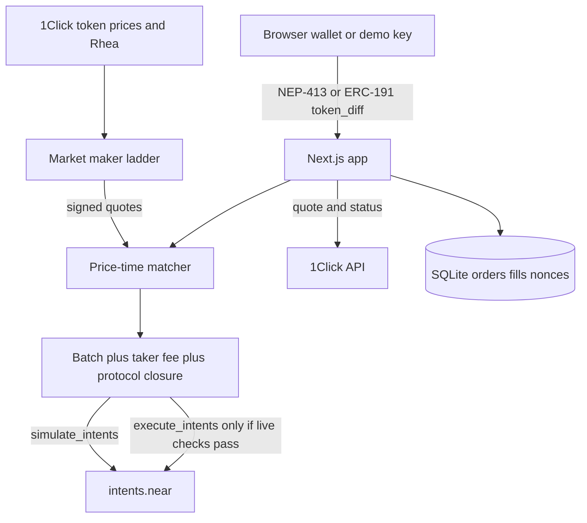

# IntentBook

IntentBook is a public limit order book for BTC, ETH, SOL, and NEAR against USDC. People who want a set price today have to use a custodian, a single-chain DEX, or a private 1Click limit order that nobody else can see. IntentBook shows the depth, matches crossing orders off chain, and settles them as signed NEAR Intents `token_diff` payloads. The batch is checked with `simulate_intents` on mainnet `intents.near`.

Track: Unstoppable DeFi (`defi`). License: Apache-2.0.

## Quickstart

Node.js 22 or newer.

```bash
npm install
npm run dev
```

Open http://127.0.0.1:43123. No wallet, no API key, and no funds are required. `INTENTBOOK_LIVE` stays unset. Copy `.env.example` to `.env` only if you want to change a default.

```bash
npm test
npm run demo:dry
```

The home page has a short explanation, then the book. Use **Demo key** if you are judging. Connect **NEAR wallet** (Meteor, HOT, MyNearWallet, HERE) or **MetaMask** when you want to sign with your own key.

## Try it

1. `npm run dev`, then open the trade page. See four pairs, a reference mid from `GET https://1click.chaindefuser.com/v0/tokens`, and a maker ladder around that mid. NEAR also shows a Rhea quote from `https://smartx.rhea.finance/swapMultiDexPath`.
2. Leave the size at one maker lot and click **Sign and place** on a buy. The demo key signs locally. A connected wallet signs the same payload. See the order leave the book and a match card whose `simulate_intents` body contains `insufficient balance or overflow` for an unfunded account. A bad signature would say `invalid signature` instead. The taker fee is 8 bps. The maker fee is 0.
3. Open **Orders**. See the fill, the raw simulation, and a **Rest a 20-second bid** action. **Cancel** removes the order here and records the nonce. **Nonce burn** shows why the chain does not have a separate invalidate call. Wait past 20 seconds and see `EXPIRED`.
4. Open **Funds**. See `mt_batch_balance_of` (zero on a fresh demo key), a dry `POST /v0/quote` from Base USDC into canonical USDC with `recipientType: INTENTS`, and a status lookup that shows `PENDING_DEPOSIT`, `REFUNDED`, `FAILED`, and the other 1Click states. Status polls every 8 seconds after you paste a deposit address. **Create deposit address** asks 1Click for a real address and is not used by the dry path. **Deposit 1 wNEAR** is signed by your NEAR wallet, not by this server. **Sign and simulate withdraw** builds an `ft_withdraw` and stops at simulation unless live mode is armed.
5. `curl http://127.0.0.1:43123/api/v1/book?pair=BTC-USDC` and `curl http://127.0.0.1:43123/api/v1/trades?pair=BTC-USDC`. See the public book and the simulate body. Signatures are not returned on GET.

## Dry-run and live mode

| Call | Live? | Sends funds? |
| --- | --- | --- |
| NEP-413 or ERC-191 sign in the browser | Yes, local demo key or the user's wallet | No, until the user confirms a wallet transaction |
| `current_salt`, `fee`, `fee_collector`, `mt_batch_balance_of`, `is_nonce_used` | Yes, view calls | No |
| `simulate_intents` | Yes, view call | No |
| `GET /v0/tokens`, `POST /v0/quote` with `dry: true`, `GET /v0/status` | Yes | No |
| Rhea `swapMultiDexPath` | Yes, quote only | No |
| `execute_intents` | Only if `INTENTBOOK_LIVE=1`, simulation succeeded, size is within 5 lots and 50 USDC, and the relayer key is set | Yes, from the relayer account |

An empty intent from the operator key simulates successfully and returns an intent hash, the current salt, and the fee. A matched `token_diff` batch from unfunded keys stops on `insufficient balance or overflow` after the signature check. Closure math (the 1 pip protocol fee on negative deltas, matching `TokenDiff::closure` in near/intents) is checked in `npm test`. The product taker fee is a separate operator `token_diff` of 8 bps. A funded simulation would be required before live mode broadcasts.

`npm run demo:dry` prints the quote, the signed batch verdict, and the successful empty-intent simulation. It does not call `execute_intents`.

This repository does not ship a relayer key. Do not commit one.

## Architecture



The maker quotes around the reference mid. A crossing order is signed at the makers' prices, so the taker keeps any price improvement, then pays 8 bps to the operator. Whole maker lots only. Size left over rests at the limit, or, for a market order, is quoted on 1Click and, for NEAR, on Rhea. Those quotes are not executed. The operator signs the taker fee and the 1 pip protocol closure.

Orders, fills, and cancelled nonces are stored in SQLite (`SQLITE_PATH`, default `.data/intentbook.sqlite`). Maker quotes stay in memory and are rebuilt from prices.

## Public API

Versioned under `/api/v1`. The machine-readable description is `/openapi.json`. A small client lives in `packages/sdk`.

Reads: book, grouped depth, candles (`1m`, `5m`, `1h`, `1d`), trades, ticker, account orders/fills/balances, compare, and best quote across the book, 1Click, and Rhea.

Writes: preview, place signed order, signed cancel, webhook registration. Webhooks send `X-IntentBook-Signature` as hex HMAC-SHA256 of the body. Failures retry at 1s, 5s, 30s, 2m, and 10m, then stop. SSE is `GET /api/v1/stream?pair=BTC-USDC`. WebSocket is `ws://127.0.0.1:43124?pair=BTC-USDC`.

Embed with:

```html
<script src="http://127.0.0.1:43123/widget.js" data-referrer="your-app" data-origin="http://127.0.0.1:43123"></script>
```

The referrer id is stored with each fill and earns `REFERRER_SHARE_BPS` of the taker fee. `GET /api/v1/referrers?id=your-app` returns the total.

## Wallets

- **Demo key**: an ed25519 key in `localStorage`. This is the fallback for judges. It is not funded.
- **NEAR wallet selector**: Meteor, HOT, MyNearWallet, and HERE. The selector restores a previous session after refresh. Named accounts sign NEP-413. **Register key** checks `has_public_key` and asks the wallet to call `add_public_key`. The server does not send that transaction.
- **MetaMask**: ERC-191 `personal_sign`. A previous connection is restored with `eth_accounts` and no popup.
- **Phantom**: raw ed25519 over the intent payload. `signer_id` is the hex public key.
- **Passkey**: sign in without a wallet. The browser creates a WebAuthn credential and later assertions are wrapped as `webauthn` payloads.
- Nonces default to the versioned form: magic `5628f6c6`, version 1, the 4-byte salt, the deadline in nanoseconds, then 15 random bytes. If `simulate_intents` rejects that nonce, the next order uses the legacy salt prefix.

## Deposits and withdrawals

- **Other chains**: `POST /api/v1/deposit-quote` calls 1Click. `dry: true` is the default and does not create a deposit address. `dry: false` asks for an address. The funds page polls `GET /v0/status` and highlights `REFUNDED` and `FAILED`.
- **NEAR**: `POST /api/v1/near-deposit` returns an unsigned `ft_transfer_call` to `intents.near` on `wrap.near`. The connected NEAR wallet signs and sends it. Do not send native NEAR to the Verifier. Wrap it first.
- **Withdraw**: `ft_withdraw` to the user's own account, or a 1Click quote from Intents USDC to another chain. Dry-run simulates. Live mode uses the same gate as a match.

Explorer links point at NearBlocks for the account and, after a broadcast, the transaction.

## Cancel

Soft cancel removes the order from the book and records the nonce in SQLite so this process will not accept it again. The Verifier burns a nonce only when `execute_intents` commits it. There is no separate invalidate method. **Nonce burn** prepares an empty intent that reuses the order nonce. That intent is simulated, and it is broadcast only when live mode passes the same checks. Dry-run does not broadcast it.

## API

See the API page in the app. Read routes:

- `GET /api/v1/book?pair=BTC-USDC`
- `GET /api/v1/trades?pair=ETH-USDC`
- `GET /api/v1/ticker`
- `GET /api/v1/orders?account=<account>`
- `GET /api/v1/health`
- `GET /api/v1/balances?account=<account>`
- `GET /api/v1/status?depositAddress=`
- `GET /api/v1/stream` (server-sent events)

Writes: `POST /api/v1/orders/preview`, `POST /api/v1/orders`, `POST /api/v1/orders/cancel`, `POST /api/v1/orders/burn-preview`, `POST /api/v1/orders/burn`, `POST /api/v1/deposit-quote`, `POST /api/v1/near-deposit`, `POST /api/v1/withdraw/preview`, `POST /api/v1/withdraw`, `POST /api/v1/quote`.

Pairs: `BTC-USDC`, `ETH-USDC`, `SOL-USDC`, `NEAR-USDC`. Asset ids are loaded from `/v0/tokens` for prices. The ids used in intents are the canonical ones checked on 11 Nov 2026: `nep141:btc.omft.near`, `nep141:eth.omft.near`, `nep141:sol.omft.near`, `nep141:wrap.near`, and NEAR USDC `nep141:17208628f84f5d6ad33f0da3bbbeb27ffcb398eac501a31bd6ad2011e36133a1`.

## Environment

| Name | Required | Purpose |
| --- | --- | --- |
| `INTENTBOOK_LIVE` | No | `1` arms `execute_intents`. Anything else is dry-run. |
| `NEAR_RELAYER_ACCOUNT` | Live only | Account that pays gas for `execute_intents`. |
| `NEAR_RELAYER_PRIVATE_KEY` | Live only | `ed25519:` secret for that account. Never commit it. |
| `INTENTBOOK_EXECUTE_GAS` | No | Default `300000000000000` (300 TGas). |
| `ONECLICK_JWT` | No | Partner JWT from https://partners.near-intents.org. Without it, 1Click charges 0.25% (25 bps). With it, 1Click charges 0.20% (20 bps). |
| `ONECLICK_APP_FEE_BPS` | No | Extra app fee in basis points on 1Click quotes. Split 50/50, and 1Click keeps at least 20 bps. |
| `ONECLICK_APP_FEE_RECIPIENT` | No | Intents account that receives the app fee. Required for the fee to be attached. |
| `REFERRER_SHARE_BPS` | No | Share of the taker fee credited to an embed referrer. Default 5000 (50%). |
| `INTENTBOOK_WS_PORT` | No | WebSocket port. Default 43124. Set `INTENTBOOK_WS=0` to disable it. |
| `INTENTBOOK_NONCE` | No | Set to `legacy` to force the old 4-byte salt nonce. Default is the versioned `5628f6c6` nonce. |
| `NEAR_RPC_URL` | No | Defaults to `https://rpc.mainnet.near.org`, then `https://rpc.fastnear.com`. |
| `INTENTS_CONTRACT` | No | Defaults to `intents.near`. |
| `ONECLICK_BASE` | No | Defaults to `https://1click.chaindefuser.com`. |
| `MM_INTERVAL_MS` | No | Maker refresh. Default 45000. |
| `SQLITE_PATH` | No | Default `.data/intentbook.sqlite`. |

## Deploy

`vercel.json` selects the Next.js framework. `npm run build` then `npm start` also works on a VM.

Vercel serverless disks are ephemeral. SQLite there lasts only as long as the instance. For a durable hosted book, set `SQLITE_PATH` on a persistent volume or run `next start` on a VM. Do not set `INTENTBOOK_LIVE=1` on a public deploy until the relayer account is funded and the size caps are acceptable.

## Limits

- The matcher is run by this process. It can order matches. The public fill log is the check. A separate chain of custody is not provided.
- User orders are one signature for the take and, if size is left, a second signature to rest. Maker lots are filled whole.
- Soft cancel removes the order here. On-chain nonce burn requires `execute_intents` and is not broadcast in dry-run.
- Salt is the live 4-byte prefix. Legacy nonces of that shape were accepted by `simulate_intents` on 11 Nov 2026. If the contract later requires the versioned nonce (`5628f6c6` magic), resting quotes must be re-signed.
- 1Click `generate-intent`, `submit-intent`, and `POST /v0/orders` are not called. Those need a partner JWT. Private 1Click limit orders are a different product: this book is public.
- A named NEAR account cannot pass live `execute_intents` until its public key is registered with `add_public_key`.
- Live settlement refuses unfunded simulations, missing relayer keys, and orders above 5 lots or 50 USDC.
- No hosted custody. Wallet deposits and withdrawals are signed by the user.

## Disclosure

Built for NEAR Hackathon in November 2026. Code was written with an AI coding agent. Libraries: Next.js, React, Tailwind CSS, Radix UI, NEAR Wallet Selector, `near-api-js`, `@noble/curves`, `@noble/hashes`, `bs58`. No pre-hackathon product code. Apache License 2.0. See `LICENSE`.
