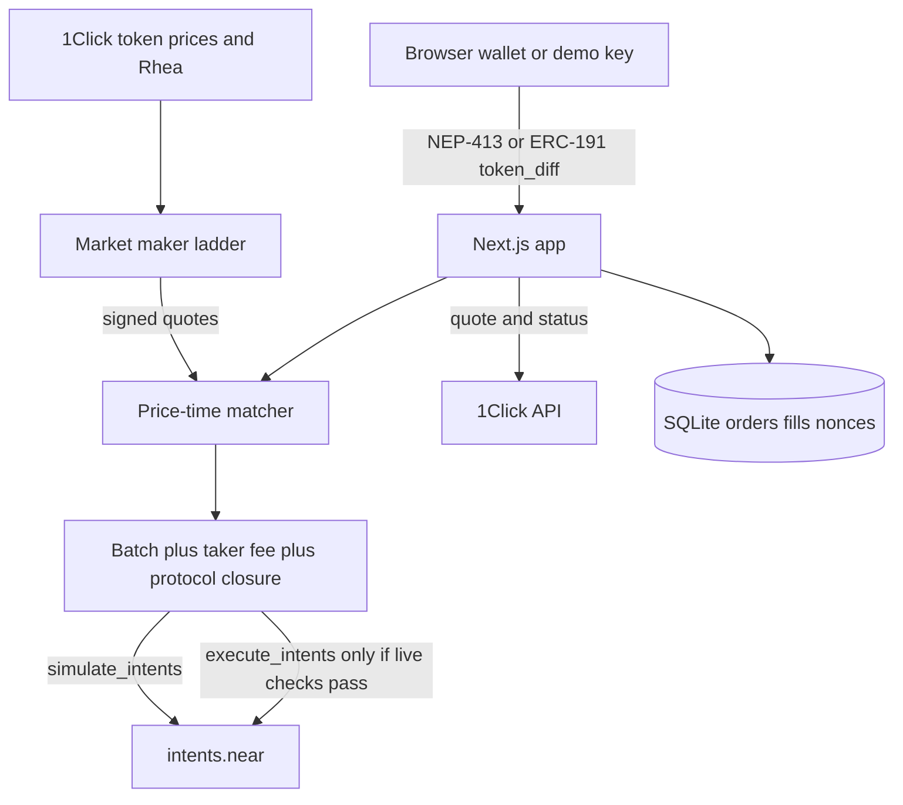

# IntentBook

A public limit order book for BTC, ETH, SOL and NEAR against USDC that settles through NEAR Intents. Every order is a `token_diff` the trader signs at their price, so nobody holds the funds and nobody can change the price. Wallets, apps and AI agents share one book.

Live: https://intentbook.up.railway.app (dry-run: every match is checked with `simulate_intents` on mainnet `intents.near`). Tracks: Unstoppable DeFi (`defi`) and Agent Economy (`agents`). License: Apache-2.0.

## Why it exists

To set a price today, you use a custodian, a single-chain DEX, or a private 1Click limit order that nobody else can see. IntentBook makes the depth public and keeps the settlement non-custodial:

- **Public depth.** Bids, asks and fills are open over REST, SSE, WebSocket and an embeddable widget. An embedding app earns half the taker fee on the fills it sends.
- **Signed, not deposited.** A resting order is a signed NEAR Intents `token_diff`. Funds stay in the trader's own `intents.near` account until a match settles.
- **Cross-chain assets in one account.** BTC, ETH and SOL trade as their NEAR Intents tokens against USDC, deposited from many chains. Traders sign with a NEAR wallet, MetaMask or Phantom.
- **Agents as first-class traders.** An MCP server gives an AI agent its own account and signing key, with a per-order cap the human sets.

## How it compares

| | Where matching happens | Assets | Custody | Notes |
| --- | --- | --- | --- | --- |
| **IntentBook** | Off chain, in this open-source server | BTC, ETH, SOL, NEAR vs USDC through NEAR Intents | None: user-signed `token_diff` | Public API, embed with fee share, MCP for agents |
| DeepBook (Sui) | Fully on chain | Sui assets | Balance manager on chain | The model for a shared book other apps plug into |
| HEX orderbook (HOT Labs) | `orderbook.fi.tg` contract, settles through NEAR Intents | HOT-ecosystem pairs such as HOT and GNK (per its SDK docs) | Omni balance | The closest prior art on NEAR Intents |
| Tonic, Spin (NEAR, 2022) | Fully on chain | NEAR-native tokens | Contract balances | Early NEAR order books |
| 1Click limit orders | Solver network | NEAR Intents assets | None | Private: no public depth |

## Unstoppable, honestly

- **Funds:** never leave the trader's `intents.near` account except in a settled batch the trader signed. If IntentBook disappears, balances are withdrawable from any NEAR Intents app.
- **Prices:** the operator cannot change a signed price or move funds. `intents.near` checks every signature and balance in the batch, or nothing moves.
- **Matching:** this is the one central piece. One server orders matches, and the public fill log is the check. The code is open source, so anyone can run a book.

## Quickstart

Node.js 22 or newer.

```bash
npm install
npm run dev
```

Open http://127.0.0.1:43123. No wallet, no API key, and no funds are required. `INTENTBOOK_LIVE` stays unset. Copy `.env.example` to `.env` only if you want to change a default.

```bash
npm test
npm run demo:dry
```

The home page explains the idea, then opens the trading terminal. The demo key is the default signer, so judges need no wallet. **Connect** switches to a NEAR wallet (Meteor, HOT, MyNearWallet, HERE), MetaMask or Phantom.

## Try it

1. `npm run dev` and open the home page. See four markets with a reference mid from `GET https://1click.chaindefuser.com/v0/tokens` and a maker ladder around it. NEAR also shows a Rhea price from `https://smartx.rhea.finance/swapMultiDexPath`.
2. In the order ticket, pick **Buy** and **Market**, keep one lot, and click **Preview**. See **What you sign**: the exact `token_diff` payload. Click **Sign & buy**. The demo key signs locally, the order takes the best ask, and a receipt appears with a **Signed · unfunded** stamp. Its raw result from `simulate_intents` says `insufficient balance or overflow`, because the signatures passed and only the balance check failed. A bad signature would say `invalid signature`. The taker fee is 8 bps and the maker fee is 0.
3. Type `sell 0.0001 btc at 200k` in the ticket's sentence box and press **Fill**. The ticket fills in a resting limit order. Tap any price in the book to use it as the limit.
4. Open **Orders** and click **Rest a 20-second bid**. **Cancel** signs a cancel message and removes the order. **Burn nonce** signs an empty intent with the order's nonce and simulates it, which is how a nonce is spent on chain. Leave a bid alone for 20 seconds and see `EXPIRED`.
5. Open **Funds**. See balances from `mt_batch_balance_of` (zero for a fresh demo key) and a dry `POST /v0/quote` from Base USDC into Intents USDC. **Track** polls `GET /v0/status` and flags `REFUNDED` and `FAILED`. A NEAR wallet can wrap and deposit NEAR, wNEAR or USDC, credited to any account. **Withdraw** signs an `ft_withdraw` and stops at simulation unless live mode is armed.
6. Run `curl http://127.0.0.1:43123/api/v1/book?pair=BTC-USDC` and `curl http://127.0.0.1:43123/api/v1/trades?pair=BTC-USDC`. See the public book and the simulation results. Signatures are not returned on GET.
7. Open **Build** to get the MCP command that lets an AI agent trade with its own key. See [AI agents (MCP)](#ai-agents-mcp).

One real mainnet trade for about $1 is described in [docs/live-test.md](docs/live-test.md).

## Dry-run and live mode

| Call | Live? | Sends funds? |
| --- | --- | --- |
| NEP-413 or ERC-191 sign in the browser | Yes, local demo key or the user's wallet | No, until the user confirms a wallet transaction |
| `current_salt`, `fee`, `fee_collector`, `mt_batch_balance_of`, `is_nonce_used` | Yes, view calls | No |
| `simulate_intents` | Yes, view call | No |
| `GET /v0/tokens`, `POST /v0/quote` with `dry: true`, `GET /v0/status` | Yes | No |
| Rhea `swapMultiDexPath` | Yes, quote only | No |
| `execute_intents` | Only if `INTENTBOOK_LIVE=1`, simulation succeeded, size is within 5 lots and 50 USDC, the relayer key is set, and (for matches) the operator and market-maker keys come from the environment | Yes, from the relayer account |

An empty intent from the operator key simulates successfully and returns an intent hash, the current salt, and the fee. A matched `token_diff` batch from unfunded keys stops on `insufficient balance or overflow` after the signature check. Closure math (the 1 pip protocol fee on negative deltas, matching `TokenDiff::closure` in near/intents) is checked in `npm test`. The product taker fee is a separate operator `token_diff` of 8 bps. A funded simulation would be required before live mode broadcasts.

`npm run demo:dry` prints the quote, the signed batch verdict, and the successful empty-intent simulation. It does not call `execute_intents`.

This repository does not ship a relayer key. Do not commit one.

## Architecture



The maker quotes around the reference mid. A crossing order is signed at the makers' prices, so the taker keeps any price improvement, then pays 8 bps to the operator. Whole maker lots only. Size left over rests at the limit, or, for a market order, is quoted on 1Click and, for NEAR, on Rhea. Those quotes are not executed. The operator signs the taker fee and the 1 pip protocol closure.

Orders, fills, and cancelled nonces are stored in SQLite (`SQLITE_PATH`, default `.data/intentbook.sqlite`). Maker quotes stay in memory and are rebuilt from prices.

## Public API

Versioned under `/api/v1`. The machine-readable description is `/openapi.json`. A small client lives in `packages/sdk`.

Reads: book, grouped depth, candles (`1m`, `5m`, `1h`, `1d`), trades, ticker, account orders/fills/balances, compare, and best quote across the book, 1Click, and Rhea.

Writes: preview, place signed order, signed cancel, webhook registration. Webhooks send `X-IntentBook-Signature` as hex HMAC-SHA256 of the body. Failures retry at 1s, 5s, 30s, 2m, and 10m, then stop. SSE is `GET /api/v1/stream?pair=BTC-USDC`. WebSocket is `ws://<host>/api/v1/ws?pair=BTC-USDC` on the same port as HTTP.

Embed with:

```html
<script src="http://127.0.0.1:43123/widget.js" data-referrer="your-app" data-origin="http://127.0.0.1:43123"></script>
```

The referrer id is stored with each fill and earns `REFERRER_SHARE_BPS` of the taker fee. `GET /api/v1/referrers?id=your-app` returns the total.

## AI agents (MCP)

`mcp/stdio.ts` is an MCP server, so an AI agent (Claude Code, Claude Desktop, Codex or any MCP client) can trade on the book with its own key.

| Tool | What it does |
| --- | --- |
| `intentbook_status` | The agent's NEAR Intents account, its guardrails, dry-run or live |
| `get_book`, `get_ticker` | Depth, mid, spread and lot size |
| `best_price` | Book versus 1Click versus Rhea for a size |
| `place_order` | Build, sign locally, submit. Crossing size matches; leftover rests |
| `cancel_order` | Signed cancel of one of the agent's orders |
| `my_orders`, `my_balances` | The agent's orders and intents.near balances |

- The key is created on first run at `~/.intentbook/agent-key.json`, or read from `INTENTBOOK_AGENT_SECRET`. Its implicit account is the agent's NEAR Intents account. The API builds each order, the MCP server signs it as NEP-413, and the key never leaves the machine.
- The human sets the guardrails: `INTENTBOOK_AGENT_MAX_USDC` (per order, default 25) and `INTENTBOOK_AGENT_PAIRS` (allowlist, for example `NEAR-USDC`). `INTENTBOOK_URL` picks the book (default the hosted one).

Add it to Claude Code:

```bash
claude mcp add intentbook -e INTENTBOOK_URL=https://intentbook.up.railway.app -e INTENTBOOK_AGENT_MAX_USDC=5 -- npx tsx /path/to/intentbook/mcp/stdio.ts
```

Try it: ask "What is the NEAR spread on IntentBook? Rest a 2 NEAR bid at 1 USDC, then cancel it." See the order appear for the agent's account on the Orders API and then show `CANCELLED`. `INTENTBOOK_URL=http://127.0.0.1:43123 npx tsx scripts/mcp-smoke.ts` runs the same steps as a script.

## Wallets

- **Demo key**: an ed25519 key in `localStorage`. This is the fallback for judges. It is not funded.
- **NEAR wallet selector**: Meteor, HOT, MyNearWallet, and HERE. The selector restores a previous session after refresh. Named accounts sign NEP-413. The server accepts a named account's signature only when the key is a full-access key of that account on NEAR (`view_access_key`) or is registered on intents.near (`has_public_key`). **Register key** checks `has_public_key` and asks the wallet to call `add_public_key`. The server does not send that transaction.
- **MetaMask**: ERC-191 `personal_sign`. A previous connection is restored with `eth_accounts` and no popup.
- **Phantom**: `raw_ed25519` over the JSON payload (`signer_id`, `verifying_contract`, `deadline`, `nonce`, `intents`). `signer_id` is the hex public key. The client asks for this with `standard: "raw_ed25519"` on preview.
- `webauthn` payloads are refused. There is no passkey wallet until P-256 verification over the intent hash is built.
- Nonces default to the versioned form: magic `5628f6c6`, version 1, the 4-byte salt, the deadline in nanoseconds, then 15 random bytes. If `simulate_intents` rejects that nonce, the next order uses the legacy salt prefix.

## Deposits and withdrawals

- **Other chains**: `POST /api/v1/deposit-quote` calls 1Click. `dry: true` is the default and does not create a deposit address. `dry: false` asks for an address. The funds page polls `GET /v0/status` and highlights `REFUNDED` and `FAILED`.
- **NEAR**: `POST /api/v1/near-deposit` returns an unsigned `ft_transfer_call` to `intents.near` on `wrap.near`. The connected NEAR wallet signs and sends it. Do not send native NEAR to the Verifier. Wrap it first.
- **Withdraw**: `ft_withdraw` to the user's own account, or a 1Click quote from Intents USDC to another chain. Dry-run simulates. Live mode uses the same gate as a match.

Explorer links point at NearBlocks for the account and, after a broadcast, the transaction.

## Cancel

Cancel is signed. `POST /api/v1/orders/cancel-preview` returns a cancel message for that order. The owner signs it with the same standard as their orders and sends `POST /api/v1/orders/cancel` with `{ signed }`. The message expires in 5 minutes, names one order, and uses a `cancel` intent that intents.near does not know, so it cannot be replayed there. Unsigned cancels are refused. A cancel removes the order from the book and records the nonce in SQLite so this process will not accept it again. The Verifier burns a nonce only when `execute_intents` commits it. There is no separate invalidate method. **Nonce burn** prepares an empty intent that reuses the order nonce. That intent is simulated, and it is broadcast only when live mode passes the same checks. Dry-run does not broadcast it.

## API

See the API page in the app. Read routes:

- `GET /api/v1/book?pair=BTC-USDC`
- `GET /api/v1/trades?pair=ETH-USDC`
- `GET /api/v1/ticker`
- `GET /api/v1/orders?account=<account>`
- `GET /api/v1/health`
- `GET /api/v1/balances?account=<account>`
- `GET /api/v1/status?depositAddress=`
- `GET /api/v1/stream` (server-sent events)

Writes: `POST /api/v1/orders/preview`, `POST /api/v1/orders`, `POST /api/v1/orders/cancel-preview`, `POST /api/v1/orders/cancel`, `POST /api/v1/orders/burn-preview`, `POST /api/v1/orders/burn`, `POST /api/v1/deposit-quote`, `POST /api/v1/near-deposit`, `POST /api/v1/withdraw/preview`, `POST /api/v1/withdraw`, `POST /api/v1/webhooks/preview`, `POST /api/v1/webhooks`, `POST /api/v1/quote`. Every write that acts for an account needs that account's signature.

Pairs: `BTC-USDC`, `ETH-USDC`, `SOL-USDC`, `NEAR-USDC`. Asset ids are loaded from `/v0/tokens` for prices. The ids used in intents are the canonical ones checked on 11 Nov 2026: `nep141:btc.omft.near`, `nep141:eth.omft.near`, `nep141:sol.omft.near`, `nep141:wrap.near`, and NEAR USDC `nep141:17208628f84f5d6ad33f0da3bbbeb27ffcb398eac501a31bd6ad2011e36133a1`.

## Environment

| Name | Required | Purpose |
| --- | --- | --- |
| `INTENTBOOK_LIVE` | No | `1` arms `execute_intents`. Anything else is dry-run. |
| `NEAR_RELAYER_ACCOUNT` | Live only | Account that pays gas for `execute_intents`. |
| `NEAR_RELAYER_PRIVATE_KEY` | Live only | `ed25519:` secret for that account. Never commit it. |
| `INTENTBOOK_EXECUTE_GAS` | No | Default `300000000000000` (300 TGas). |
| `ONECLICK_JWT` | No | Partner JWT from https://partners.near-intents.org. Without it, 1Click charges 0.25% (25 bps). With it, 1Click charges 0.20% (20 bps). |
| `ONECLICK_APP_FEE_BPS` | No | Extra app fee in basis points. Attached only when `ONECLICK_JWT` is set. Split 50/50, and 1Click keeps at least 20 bps. |
| `ONECLICK_APP_FEE_RECIPIENT` | No | Intents account that receives the app fee. Also required before the fee is attached. |
| `REFERRER_SHARE_BPS` | No | Share of the taker fee credited to an embed referrer. Default 5000 (50%). |
| `PORT` | No | HTTP and WebSocket port. Railway sets this. Fallback 43123. |
| `INTENTBOOK_NONCE` | No | Set to `legacy` to force the old 4-byte salt nonce. Default is the versioned `5628f6c6` nonce. |
| `INTENTBOOK_OPERATOR_SECRET` | Live matches | ed25519 secret (64 hex characters or `ed25519:<base58>`) for the operator that signs the taker fee and the protocol closure. Its implicit account receives the fees. Without it a throwaway key is made at each boot and live matches are refused. |
| `INTENTBOOK_MM_SECRET` | Live matches | ed25519 secret for the market-maker ladder. It can be the same key as the operator. |
| `INTENTBOOK_LOT_<BASE>` | No | Maker lot override, for example `INTENTBOOK_LOT_NEAR=0.1` for a small live test. Defaults: BTC 0.0001, ETH 0.002, SOL 0.1, NEAR 2. |
| `NEAR_RPC_URL` | No | Defaults to `https://rpc.mainnet.near.org`, then `https://rpc.fastnear.com`. |
| `INTENTS_CONTRACT` | No | Defaults to `intents.near`. |
| `ONECLICK_BASE` | No | Defaults to `https://1click.chaindefuser.com`. |
| `MM_INTERVAL_MS` | No | Maker refresh. Default 45000. |
| `SQLITE_PATH` | No | Default `.data/intentbook.sqlite`. |

## Deploy to Railway

`railway.json` builds with `npm run build` and starts with `npm start`. The process listens on `0.0.0.0` and `$PORT` (fallback 43123). HTTP, SSE, and the WebSocket upgrade for `/api/v1/ws` share that one port. The healthcheck path is `/api/v1/health`.

Attach a volume mounted at `/data` and set:

```text
SQLITE_PATH=/data/intentbook.db
```

The directory is created if it is missing. Do not commit secrets.

| Variable | Railway value |
| --- | --- |
| `PORT` | Set by Railway. Do not hardcode it. |
| `SQLITE_PATH` | `/data/intentbook.db` |
| `ONECLICK_JWT` | Partner JWT. Empty keeps the public 1Click fee and sends no appFees. |
| `ONECLICK_APP_FEE_BPS` | Optional. Used only when `ONECLICK_JWT` is set. |
| `ONECLICK_APP_FEE_RECIPIENT` | Optional Intents account for that fee. |
| `INTENTBOOK_LIVE` | Leave unset or `0`. `1` arms `execute_intents`. |
| `NEAR_RELAYER_ACCOUNT` | Only if live mode is armed. |
| `NEAR_RELAYER_PRIVATE_KEY` | Only if live mode is armed. Never commit it. |
| `NEAR_RPC_URL` | Optional. |
| `INTENTS_CONTRACT` | Optional. Default `intents.near`. |
| `ONECLICK_BASE` | Optional. |
| `REFERRER_SHARE_BPS` | Optional. Default 5000. |
| `MM_INTERVAL_MS` | Optional. Default 45000. |
| `INTENTBOOK_NONCE` | Optional. `legacy` forces the old nonce. |
| `INTENTBOOK_OPERATOR_SECRET` | Only if live mode is armed. Never commit it. |
| `INTENTBOOK_MM_SECRET` | Only if live mode is armed. May equal the operator secret. |
| `INTENTBOOK_LOT_NEAR` | Optional. `0.1` for a small live test. |

`vercel.json` remains for a Vercel build. Serverless disks there are ephemeral, so a durable book belongs on Railway with the volume above. Do not set `INTENTBOOK_LIVE=1` on a public deploy until the relayer account is funded and the size caps are acceptable.

## Limits

- The matcher is run by this process. It can order matches. The public fill log is the check. A separate chain of custody is not provided.
- User orders are one signature for the take and, if size is left, a second signature to rest. Maker lots are filled whole.
- Cancel removes the order here. On-chain nonce burn requires `execute_intents` and is not broadcast in dry-run.
- A preview does not hold maker lots. Two takers can preview the same lot; the first valid signature fills it and the second gets 409 and reviews again.
- Salt is the live 4-byte prefix. Legacy nonces of that shape were accepted by `simulate_intents` on 11 Nov 2026. If the contract later requires the versioned nonce (`5628f6c6` magic), resting quotes must be re-signed.
- 1Click `generate-intent`, `submit-intent`, and `POST /v0/orders` are not called. Those need a partner JWT. Private 1Click limit orders are a different product: this book is public.
- A named NEAR account cannot pass live `execute_intents` until its public key is registered with `add_public_key`.
- Live settlement refuses unfunded simulations, missing relayer keys, throwaway operator or market-maker keys, and orders above 5 lots or 50 USDC. Live withdraws are capped at 50 USDC of value and limited to USDC and the book's base assets.
- Webhook URLs must be https on a public host in production. Hostnames are not resolved, so a public name that points at a private address is not caught.
- No hosted custody. Wallet deposits and withdrawals are signed by the user.

## Disclosure

Built for NEAR Hackathon in November 2026. Code was written with an AI coding agent. Libraries: Next.js, React, Tailwind CSS, Radix UI, NEAR Wallet Selector, `near-api-js`, `@noble/curves`, `@noble/hashes`, `bs58`. No pre-hackathon product code. Apache License 2.0. See `LICENSE`.
