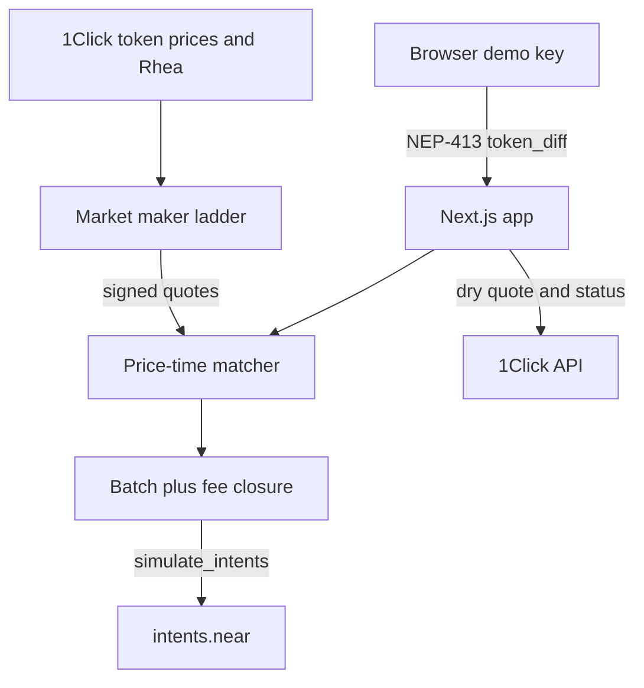

# IntentBook

IntentBook is a public limit order book for BTC, ETH, SOL, and NEAR against USDC. People who want a set price today have to use a custodian, a single-chain DEX, or a private 1Click limit order that nobody else can see. IntentBook shows the depth, matches crossing orders off chain, and settles them as signed NEAR Intents `token_diff` payloads. The batch is checked with `simulate_intents` on mainnet `intents.near`.

Track: Unstoppable DeFi (`defi`). License: Apache-2.0.

## Quickstart

Node.js 22 or newer.

```bash
npm install
npm run dev
```

Open http://127.0.0.1:43123. No wallet, no API key, and no funds. `INTENTBOOK_LIVE` stays unset. Copy `.env.example` to `.env` only if you want to change a default.

```bash
npm test
npm run demo:dry
```

## Try it

1. `npm run dev`, then open the trade page. See four pairs, a reference mid from `GET https://1click.chaindefuser.com/v0/tokens`, and a maker ladder around that mid. NEAR also shows a Rhea quote from `https://smartx.rhea.finance/swapMultiDexPath`.
2. Leave the size at one maker lot and click **Sign and place** on a buy. See the order leave the book and a match card whose `simulate_intents` body is `insufficient balance or overflow`. That is the real mainnet result for unfunded accounts. A bad signature would say `invalid signature` instead.
3. Open **Orders**. See the fill, the raw simulation, and a **Rest a 20-second bid** action. Wait past 20 seconds and see `EXPIRED`. Cancel is a soft cancel: the order leaves the book and the nonce is not burned.
4. Open **Funds**. See `mt_batch_balance_of` (zero on a fresh demo key), a dry `POST /v0/quote` from Base USDC into canonical USDC with `recipientType: INTENTS`, and a status lookup that shows `PENDING_DEPOSIT`, `REFUNDED`, `FAILED`, and the other 1Click states.
5. `curl http://127.0.0.1:43123/api/v1/book?pair=BTC-USDC` and `curl http://127.0.0.1:43123/api/v1/trades?pair=BTC-USDC`. See the public book and the simulate body. Signatures are not returned on GET.

## What dry-run does

| Call | Live? | Sends funds? |
| --- | --- | --- |
| NEP-413 sign in the browser | Yes, local key in localStorage | No |
| `current_salt`, `fee`, `fee_collector`, `mt_batch_balance_of`, `is_nonce_used` | Yes, view calls | No |
| `simulate_intents` | Yes, view call | No |
| `GET /v0/tokens`, `POST /v0/quote` with `dry: true`, `GET /v0/status` | Yes | No |
| Rhea `swapMultiDexPath` | Yes, quote only | No |
| `execute_intents` | Never, even if `INTENTBOOK_LIVE=1` | No |

An empty intent from the operator key simulates successfully and returns an intent hash, the current salt, and the fee. A matched `token_diff` batch from unfunded keys stops on `insufficient balance or overflow` after the signature check. Closure math (the 1 pip protocol fee on negative deltas, matching `TokenDiff::closure` in near/intents) is checked in `npm test`. A funded simulation would be required before the contract emits `token_diff` events for a real batch.

`npm run demo:dry` prints the quote, the signed batch verdict, and the successful empty-intent simulation. Sample from 11 Nov 2026:

```text
protocol fee 1 pip(s), salt 252812b3
BTC mid 74336.65 USDC via 1click:/v0/tokens
NEAR token mid 3.69, Rhea mid 3.6893
matched batch simulate: unfunded
empty-intent simulate: executed
dry quote: 20 Base USDC -> 19.997422 canonical USDC on Intents (not executed)
```

There is no mainnet fill, deposit, or withdrawal transaction hash. This build does not broadcast.

## Architecture



The maker quotes around the reference mid. A crossing order is signed at the makers' prices, so the taker keeps any price improvement. Whole maker lots only. Size left over rests at the limit, or, for a market order, is quoted on 1Click and not executed. The operator closure intent nets the 1 pip protocol fee. Maker fee is zero. The product taker fee is zero in this build so the signed amounts match the price on screen.

## API

See the API page in the app. Read routes:

- `GET /api/v1/book?pair=BTC-USDC`
- `GET /api/v1/trades?pair=ETH-USDC`
- `GET /api/v1/ticker`
- `GET /api/v1/orders?account=<64 hex>`
- `GET /api/v1/health`
- `GET /api/v1/balances?account=<64 hex>`
- `GET /api/v1/status?depositAddress=`
- `GET /api/v1/stream` (server-sent events)

Writes: `POST /api/v1/orders/preview`, `POST /api/v1/orders`, `POST /api/v1/orders/cancel`, `POST /api/v1/deposit-quote`, `POST /api/v1/quote`.

Pairs: `BTC-USDC`, `ETH-USDC`, `SOL-USDC`, `NEAR-USDC`. Asset ids are loaded from `/v0/tokens` for prices. The ids used in intents are the canonical ones checked on 11 Nov 2026: `nep141:btc.omft.near`, `nep141:eth.omft.near`, `nep141:sol.omft.near`, `nep141:wrap.near`, and NEAR USDC `nep141:17208628f84f5d6ad33f0da3bbbeb27ffcb398eac501a31bd6ad2011e36133a1`.

## Environment

| Name | Required | Purpose |
| --- | --- | --- |
| `INTENTBOOK_LIVE` | No | Recognized. `1` is still refused. This build never broadcasts. |
| `ONECLICK_JWT` | No | Partner JWT from https://partners.near-intents.org. Without it, 1Click adds its public fee (25 bps on non-`ANY_INPUT` quotes). |
| `NEAR_RPC_URL` | No | Defaults to `https://rpc.mainnet.near.org`, then `https://rpc.fastnear.com`. |
| `INTENTS_CONTRACT` | No | Defaults to `intents.near`. |
| `ONECLICK_BASE` | No | Defaults to `https://1click.chaindefuser.com`. |
| `MM_INTERVAL_MS` | No | Maker refresh. Default 45000. |

Do not commit `.env`. Keys for the demo maker, the operator closure, and the browser demo account are generated in memory or in `localStorage`. They are not in git.

## Limits

- The matcher is run by this process. It can order matches. The public fill log is the check. A separate chain of custody is not provided.
- User orders are one signature for the take and, if size is left, a second signature to rest. Maker lots are filled whole.
- Soft cancel removes the order here. There is no tested on-chain nonce burn.
- Salt is the live 4-byte prefix. Legacy nonces of that shape were accepted by `simulate_intents` on 11 Nov 2026. If the contract later requires the versioned nonce (`5628f6c6` magic), resting quotes must be re-signed.
- 1Click `generate-intent`, `submit-intent`, and `POST /v0/orders` are not called. Those need a partner JWT. Private 1Click limit orders are a different product: this book is public.
- No wallet selector, no deposit broadcast, no `processWithdrawal`, no hosted deploy.
- The book is memory plus `.data/state.json` for your own orders. It is not consensus.

## Disclosure

Built for NEAR Hackathon in November 2026. Code was written with an AI coding agent. Libraries: Next.js, React, Tailwind CSS, Radix UI, `@noble/curves`, `@noble/hashes`, `bs58`. No pre-hackathon product code. Apache License 2.0. See `LICENSE`.
